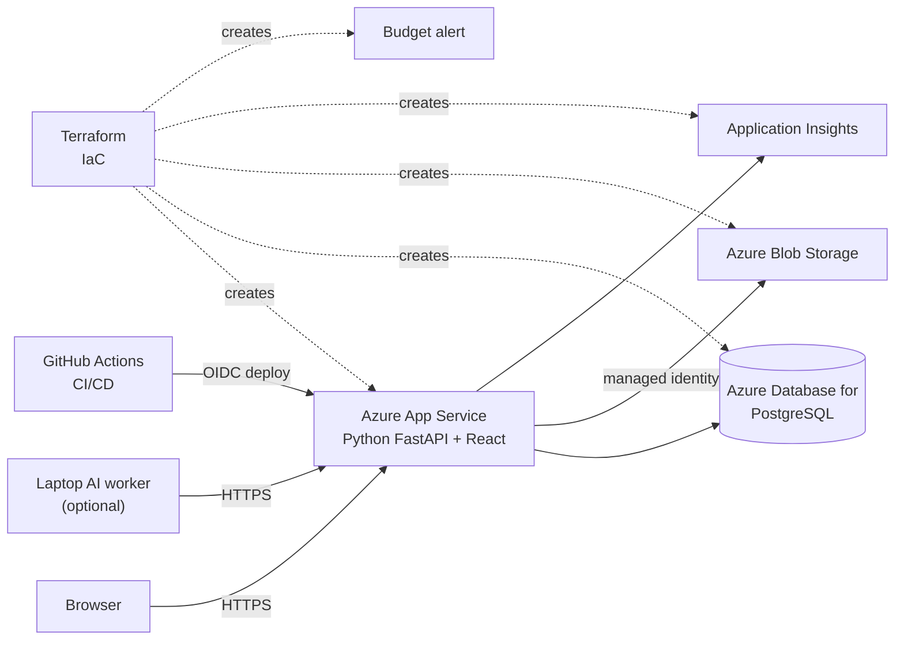

<p align="center"></p>

<h1 align="center">ImageVault</h1>

<p align="center">A cloud photo vault that finds duplicate photos, built on Microsoft Azure<br>with Terraform and GitHub Actions.</p>

<p align="center">
  <a href="https://github.com/Arnav-Dugad/imagevault-ai/actions/workflows/ci-cd.yml"></a>
</p>

---

## What it does

- **Upload** by dragging photos anywhere on the page or choosing files.
- **Duplicates:** finds exact copies (stored only once) and resized, compressed or edited versions. Compare them with a slider, see the biggest space-wasters, and delete the extras. Uploading a photo that's already stored gives a warning first.
- **Bursts:** photos taken seconds apart are grouped, and the sharpest one is picked for you.
- **People:** recognises the same person across photos, even in group photos. Name people, and merge or split them by hand when the AI gets it wrong.
- **Albums:** make your own, or use the ones made automatically (Beach, Food & drink, Pets, Mountains, City, Sunsets, Documents & receipts, Screenshots, Memes, Forwarded and more). New albums get name suggestions from the words in their photos.
- **Smart search:** describe a photo ("a dog on a beach", "a bridge at night") instead of remembering its name.
- **Text in photos:** words on signs, receipts and boards are read in English, Hindi, Tamil and Telugu (OCR). Search finds them (with the matching words outlined, even on thumbnails), you can copy the text in one click, and phone numbers, dates, prices, emails and links are picked out, ready to tap.
- **Batch editing:** select many photos (Shift-click for a range, or Select all) to favourite, add to an album, download as a ZIP or delete.
- **Browse** with sort (date taken, size, name), a date range filter, favourites, three thumbnail sizes and a full-screen viewer.
- **Cloud page:** live health of every Azure service, this month's Azure cost with a forecast for the month, storage used (with an estimated monthly cost and the space saved by removing duplicates), a one-click reset for demos, and the architecture.

The AI is free: the models run inside the app (on your laptop or in App Service), with no paid API and no photos sent to another company.

Try it with the [demo photos](frontend/public/demo-photos.zip): 97 photos from Unsplash and Wikimedia Commons, with copies, a burst, look-alikes, portraits, signs in English, Hindi, Tamil and Telugu, a receipt, screenshots, memes and WhatsApp-style forwards. The zip's `README.txt` says what each one shows.

## Cloud architecture



| Cloud service / tool | What it does in ImageVault |
|---|---|
| **Azure App Service** (Linux, Python) | Hosts the website and API over HTTPS |
| **Azure Database for PostgreSQL** (Flexible Server) | Stores photo details and duplicate matches |
| **Azure Blob Storage** | Stores the photos and thumbnails |
| **Application Insights** (+ Log Analytics) | Monitors requests, errors, response times and logs |
| **Free AI models** (CLIP, YuNet, SFace, PaddleOCR text readers via ONNX Runtime + OpenCV) on **your laptop** (edge) or in App Service, chosen with a switch | People, smart search, text search and same-subject suggestions, at no extra cost |
| **Terraform** | Creates all of the above with one command (Infrastructure as Code) |
| **GitHub Actions** | Tests every push and deploys `main` to Azure (CI/CD) |
| **Cost Management** (budget + Query API) | Emails alerts at 50%, 80% and forecast 100% of the US$5 monthly budget; the Cloud page shows the live month-to-date cost |
| **Managed identities + OIDC** | No storage keys and no deployment passwords |

## Run it on your computer

No Azure account needed: locally ImageVault uses a SQLite file and a folder instead of PostgreSQL and Blob Storage. You need [Python 3.11+](https://www.python.org/downloads/) and [Node.js 20+](https://nodejs.org/).

```bash
git clone https://github.com/Arnav-Dugad/imagevault-ai.git
cd imagevault-ai

python -m venv .venv
.venv\Scripts\activate            # Windows   (Mac/Linux: source .venv/bin/activate)
pip install -r requirements-dev.txt

cd frontend && npm install && npm run build && cd ..

python -m app                     # then open http://127.0.0.1:8000
```

The first time it starts, ImageVault downloads its free AI models (about 235 MB, once) into `data/models`. To run without AI, set `IMAGEVAULT_AI=off`.

**AI on your laptop for the Azure website (edge computing):** after deploying, run `python -m app.worker` on your laptop. It connects to the website over HTTPS, so it works on any Wi-Fi, and analyses new photos for the live site. A switch on the Cloud page chooses where the AI runs: automatic, your laptop, or Azure. On Windows, double-click `start-ai-worker.cmd` to run it as an icon next to the clock, with Start and Stop. See [step 8 of the deployment guide](docs/azure-deployment.md#step-8-recommended-run-the-ai-on-your-laptop).

While working on the website, run `python -m uvicorn app.server:app --reload` in one terminal and `npm run dev` in `frontend/` in another, then open http://localhost:5173.

**Tests:** `pytest` and `ruff check app tests` (backend), `npm run lint` (website).

## Deploy to Azure

Follow **[docs/azure-deployment.md](docs/azure-deployment.md)**. In short:

```powershell
az login
cd infra
copy terraform.tfvars.example terraform.tfvars   # fill in your details
terraform init
terraform apply                                   # creates everything (≈10 minutes)
terraform output github_setup_commands            # run the printed commands once
git push                                          # GitHub Actions deploys the site
```

## Project structure

```
app/            Python backend: API, duplicates, free AI, albums, database, storage, monitoring
frontend/       React website (Vite + Tailwind CSS); public/demo-photos.zip
infra/          Terraform: every Azure resource
tests/          Automated tests (run against SQLite and against PostgreSQL + Azure Storage emulator)
.github/        CI/CD pipeline
docs/           Deployment guide, technical design document, how it works, demo guide
```

## Documentation

- [Azure deployment guide](docs/azure-deployment.md): step by step, for Azure beginners
- [Technical design document](docs/technical-design-document.md): the course deliverable
- [How it works](docs/how-it-works.md): duplicate detection and the free AI explained, with measured accuracy
- [Demo guide](docs/demo-guide.md): a script for the live presentation
- [Setup guide (PDF)](docs/ImageVault-setup-guide.pdf): step by step, how to run it on your computer and on Azure

## License

[MIT](LICENSE). Demo photos are from [Unsplash](https://unsplash.com/license) and Wikimedia Commons; credits are in the zip's `README.txt`. AI models: CLIP (MIT, OpenAI), YuNet (MIT) and SFace (Apache 2.0) from the [OpenCV Zoo](https://github.com/opencv/opencv_zoo).
