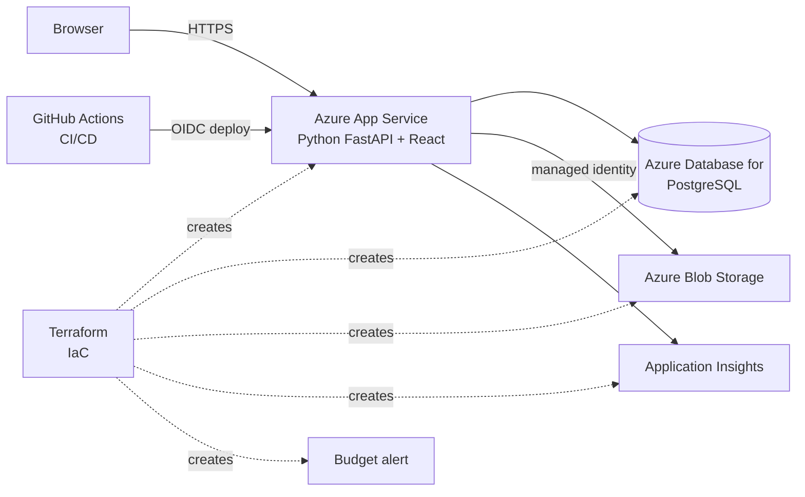

<p align="center"></p>

<h1 align="center">ImageVault</h1>

<p align="center">A cloud photo vault that finds duplicate photos, built on Microsoft Azure<br>with Terraform and GitHub Actions.</p>

<p align="center">
  <a href="https://github.com/Arnav-Dugad/imagevault-ai/actions/workflows/ci-cd.yml"></a>
</p>

---

## What it does

- **Upload photos** in the browser by dragging them in (JPG, PNG, WEBP, GIF, BMP).
- **Finds exact copies:** the same file uploaded twice. Each identical file is stored only once.
- **Finds similar photos:** resized, compressed or edited versions of the same picture, using perceptual hashing.
- **Review duplicates** side by side and delete the copies you don't need.
- **Free AI recognition** that runs inside the app (no paid API, photos never leave your cloud):
  - 👤 **People:** recognises the same person across photos, even in a group photo, and lets you name them;
  - 🔍 **Smart search:** find photos by describing them, like "a cat", "a palace at sunset" or "a man in a suit";
  - 🏛️ **Same subject, different shot:** suggests photos of the same scene taken from another angle or in other colours.
- **Cloud page:** a live view of every Azure service behind the site, with health and response time.

Try it with the [demo photos](frontend/public/demo-photos.zip). They're real photos from Unsplash and Wikimedia Commons, with copies ImageVault should catch, look-alikes it should *not* match, and portraits for the People page.

## Cloud architecture



| Cloud service / tool | What it does in ImageVault |
|---|---|
| **Azure App Service** (Linux, Python) | Hosts the website and API over HTTPS |
| **Azure Database for PostgreSQL** (Flexible Server) | Stores photo details and duplicate matches |
| **Azure Blob Storage** | Stores the photos and thumbnails |
| **Application Insights** (+ Log Analytics) | Monitors requests, errors, response times and logs |
| **Free AI models** (CLIP, YuNet, SFace via ONNX Runtime + OpenCV) on **your laptop** (edge), with App Service as backup | People, smart search and same-subject suggestions, at no extra cost |
| **Terraform** | Creates all of the above with one command (Infrastructure as Code) |
| **GitHub Actions** | Tests every push and deploys `main` to Azure (CI/CD) |
| **Cost Management budget** | Emails alerts at 50%, 80% and forecast 100% of the monthly budget |
| **Managed identities + OIDC** | No storage keys and no deployment passwords |

## Run it on your computer

No Azure account needed: locally ImageVault uses a SQLite file and a folder instead of PostgreSQL and Blob Storage. You need [Python 3.11+](https://www.python.org/downloads/) and [Node.js 20+](https://nodejs.org/).

```bash
git clone https://github.com/Arnav-Dugad/imagevault-ai.git
cd imagevault-ai

python -m venv .venv
.venv\Scripts\activate            # Windows   (Mac/Linux: source .venv/bin/activate)
pip install -r requirements-dev.txt

cd frontend && npm install && npm run build && cd ..

python -m app                     # then open http://127.0.0.1:8000
```

The first time it starts, ImageVault downloads its free AI models (about 190 MB, once) into `data/models`. To run without AI, set `IMAGEVAULT_AI=off`.

**AI on your laptop for the Azure website (edge computing):** after deploying, run `python -m app.worker` on your laptop. It analyses new photos for the live site, and the website takes over automatically whenever the laptop is off. See [step 8 of the deployment guide](docs/azure-deployment.md#step-8-recommended-run-the-ai-on-your-laptop).

While working on the website, run `python -m uvicorn app.server:app --reload` in one terminal and `npm run dev` in `frontend/` in another, then open http://localhost:5173.

**Tests:** `pytest` and `ruff check app tests` (backend), `npm run lint` (website).

## Deploy to Azure

Follow **[docs/azure-deployment.md](docs/azure-deployment.md)**. In short:

```powershell
az login
cd infra
copy terraform.tfvars.example terraform.tfvars   # fill in your details
terraform init
terraform apply                                   # creates everything (≈10 minutes)
terraform output github_setup_commands            # run the printed commands once
git push                                          # GitHub Actions deploys the site
```

## Project structure

```
app/            Python backend: API, duplicate detection, free AI, database, storage, monitoring
frontend/       React website (Vite + Tailwind CSS); public/demo-photos.zip
infra/          Terraform: every Azure resource
tests/          Automated tests (run against SQLite and against PostgreSQL + Azure Storage emulator)
.github/        CI/CD pipeline
docs/           Deployment guide, technical design document, how it works, demo guide
```

## Documentation

- [Azure deployment guide](docs/azure-deployment.md): step by step, for Azure beginners
- [Technical design document](docs/technical-design-document.md): the course deliverable
- [How it works](docs/how-it-works.md): duplicate detection and the free AI explained, with measured accuracy
- [Demo guide](docs/demo-guide.md): a script for the live presentation

## License

[MIT](LICENSE). Demo photos are from [Unsplash](https://unsplash.com/license) and Wikimedia Commons; credits are in the zip's `README.txt`. AI models: CLIP (MIT, OpenAI), YuNet (MIT) and SFace (Apache 2.0) from the [OpenCV Zoo](https://github.com/opencv/opencv_zoo).
