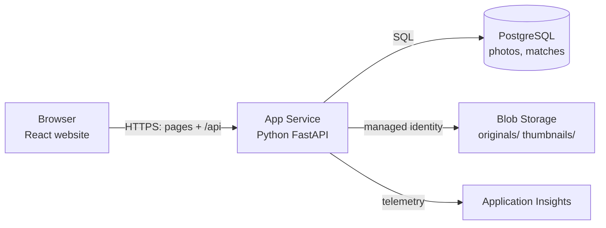
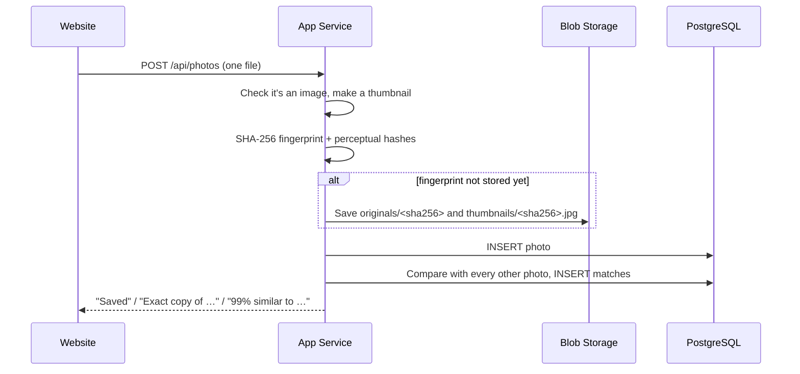
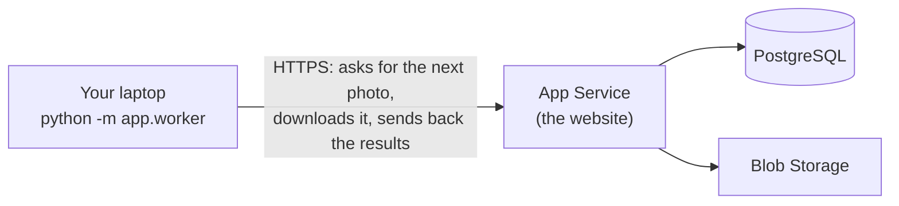

# How ImageVault works

## The big picture

ImageVault is a website. A single Python program ([FastAPI](https://fastapi.tiangolo.com/)) serves the React website and a JSON API (`/api/...`). On Azure it runs on **App Service** and uses three managed services: **PostgreSQL** for data, **Blob Storage** for files and **Application Insights** for monitoring.

The same code also runs on a laptop: without any Azure settings it falls back to a SQLite file and a local folder. That keeps development and testing simple.

## What happens when you upload a photo

The website uploads photos one at a time, so each one is compared with the photos uploaded before it, and each gets its own progress bar.

## How duplicates are detected

### Exact copies: SHA-256

A **SHA-256 hash** turns a file's bytes into a 64-character fingerprint. If even one byte changes, the fingerprint is completely different. So two files with the same fingerprint are identical.

The fingerprint is also the **file name in Blob Storage** (*content-addressed storage*). When the same photo is uploaded twice, the file is stored only once and both database rows point to it. The file is deleted only when the last photo using it is deleted.

### Similar photos: perceptual hashes

A resized or re-compressed copy has different bytes, so its SHA-256 differs. To catch it, ImageVault computes two **perceptual hashes**: 64-bit summaries of what the picture *looks like* (see `app/photos.py`).

- **dHash (difference hash):** shrink the photo to 9×8 grey pixels. For each pixel, write 1 if it's brighter than its right-hand neighbour, otherwise 0. That gives 64 bits.
- **pHash (perceptual hash):** shrink to 32×32 grey pixels and apply a *discrete cosine transform* (the maths behind JPEG). Keep the 8×8 lowest frequencies, which describe the overall shapes and lighting, and write 1 for each one above the median.

Resizing, compression and small edits barely change these bits. To compare two photos, ImageVault counts how many of the 64 bits differ (the **Hamming distance**):

| Result | Rule |
|---|---|
| Exact copy | Same SHA-256 |
| Similar | pHash differs by ≤ 10 bits **and** dHash differs by ≤ 12 bits **and** the photos have a similar shape (aspect ratio within 15%) |
| Different | Anything else |

The similarity shown is `1 − (pHash bits + dHash bits) / 128`, capped at 99%, because 100% means byte-for-byte identical.

The demo photos show both sides: a resized, a compressed and an edited copy are caught, while two different pug photos and two different waterfalls are *not* matched.

**Limits:** heavy crops, rotations, mirrored photos and different shots of the same scene usually aren't detected. That's on purpose, to keep false matches rare. Comparing a new photo with every stored photo is fine for thousands of photos; for millions you'd add an index (see the technical design document).

### Grouping and the "best copy"

Matching photos are joined into groups with a **union-find** algorithm. In each group, ImageVault suggests keeping the photo with the most pixels, then the largest file (least compressed), then the oldest upload. **Remove exact copies** deletes only identical files and keeps the first upload. Similar photos are never deleted automatically.

## Free AI recognition

ImageVault runs small open-source AI models **on your own machines**, using ONNX Runtime and OpenCV: on your laptop when it's online, otherwise inside the App Service. There's no paid AI API, no per-photo charge and no usage limit, and photos are never sent to another company. The models (about 240 MB) are downloaded once from fixed versions and checked against SHA-256 fingerprints (`app/ai.py`). With all of them loaded, the app uses about 320 MB of memory, which fits the free F1 plan's 1 GB.

| Model | License | What it does | Used for |
|---|---|---|---|
| **CLIP** ViT-B/32 (OpenAI, 8-bit quantised) | MIT | Turns a photo, or a sentence, into 512 numbers that describe its meaning | Smart search, "same subject" |
| **YuNet** (OpenCV Zoo) | MIT | Finds faces in a photo | People |
| **SFace** (OpenCV Zoo) | Apache 2.0 | Turns a face into 128 numbers; the same person gives similar numbers | People |
| **PP-OCRv3 detector** (OpenCV Zoo) | Apache 2.0 | Finds where text is written in a photo | Text search |
| **PaddleOCR readers** (PP-OCRv5 English; PP-OCRv3 Hindi, Tamil, Telugu; ONNX) | Apache 2.0 | Read a whole line of text, with punctuation and capitals | Text search, phone numbers, dates, prices |

Analysis runs in a **background worker** (`app/intelligence.py`): uploads return immediately, and the Home page shows progress. On Azure, the models are kept in `/home/models` so they survive restarts.

### Laptop first, cloud as backup (edge computing)

The AI work is split in two:

- **Computing** (the slow part: running the models) happens on your laptop (`python -m app.worker`), or inside the website. It needs no database.
- **Saving** (grouping faces into people, finding same-subject photos) always happens in the website, which owns the database and storage.

The laptop logs in to the website like a browser and asks `POST /api/worker/next` for a photo. It downloads the photo, runs the models and sends the results to `POST /api/worker/result/{id}`. Because this is ordinary HTTPS, it works on any Wi-Fi, and the laptop never holds the database password.

Each request is also a *heartbeat* in a `workers` table. While a laptop is online, the website leaves new photos to it, and only steps in if the laptop has been silent for 20 seconds or a photo has waited more than 5 minutes. A switch on the Cloud page can also keep the work on the laptop only, or on Azure only.

Photos are *claimed* with an atomic `UPDATE … WHERE ai_status IS NULL`, so no photo is analysed twice. If a worker disappears mid-photo, its claim is released and another worker retries it. Tested locally with the switch set to *My laptop*: the laptop worker analysed all the demo photos over HTTP while the website only stored the results.

### Text in photos (OCR)

The PP-OCR detector finds text regions and each one is straightened. PaddleOCR's English reader reads the whole line, keeping capitals, spaces and punctuation ("Tel:010-265.33.99", "Datum: 26/01/2021", "Rs 1,250.00"). Unless English is already very sure of the line, readers for Hindi (Devanagari), Tamil, Telugu and Kannada read it too; the most confident reading wins, but an Indian-language reading only counts if at least 80% of its letters are in that script and it uses at least 3 different letters (the Telugu reader once read a row of light bulbs as "ంంంం"). Lines any reader is less than 85% sure about are dropped. To stay quick, the Indian languages are only tried on the 20 clearest text areas, and not on lines where English found two real words.

Each word is stored with where it is (the reader reports where along the line each letter is). The normal search box searches the text ignoring spaces, capitals and punctuation, so "las vegas", "சென்னை", "स्टेशन" and "అంగల" all work, and the matching words are outlined on the thumbnails and on the photo, where all the words light up one after another as it opens. Smart search gives a photo a bonus when the words of the search are written in it, so "menu with nachos" finds a menu board. The photo viewer has a **Copy** button for the whole text.

**Phone numbers, dates, prices, emails and links** are picked out of the text with simple, strict rules (`app/textinfo.py`): a phone number needs a "+", a word like "Tel" or "Call" in front, or 10–12 digits (so "5841 5855" on a sign is not one); dates are read day-first, as in India; prices need a currency sign or "/-", or two decimals. They appear as chips you can tap to call, email, open or copy. A phone number can be saved as a contact card (.vcf) and a date as an all-day calendar reminder (.ics); both files are made in the browser. **QR codes** are read with OpenCV, outlined on the photo, and their text becomes a chip and is searchable.

On the demo set, the receipt gives its phone number, date and four prices, the station boards are read in Tamil, Hindi and Telugu as well as English, and the temple notice in Kannada. Reading takes about 0.3 s for a sign on a laptop, under 1 s for a receipt or a busy street, and about 4 s for a full typed page. Bengali is not read, because PaddleOCR has no Bengali reader. Its Kannada reader wasn't published in the format the app uses, so it was converted with `paddle2onnx` and is downloaded from this project's GitHub release, checked by its SHA-256 like the other models.

### Memes and forwarded images

A **meme** is big caption text at the top and at the bottom of a photo (letters at least 5% of the photo's height, at most 30 words). Shop signs usually have big text at the top only, so they aren't caught. A **forwarded** image is named the way WhatsApp, Telegram or Signal save photos ("IMG-20251024-WA0007.jpg", "WhatsApp Image ..."), or is a JPEG of at most 1600 px with no camera details and a JPEG quality of 70 or less (estimated from its compression tables): that is what messaging apps send. Camera photos keep their details and are saved at quality 85–95. Both are automatic albums, and are offered (unticked) in the "Free up" list. On the demo set each finds exactly its 2 photos.

### Receipts

`app/receipts.py` reads a receipt from its text: the **shop** is the first top line that is mostly letters and isn't a heading like "TAX INVOICE"; the **date** is the first date (day first); the **total** is the amount on the last "total" line that isn't a subtotal, or just after it, or a bare amount just before it (the text reader often reads the right-hand column first). Dates and times on that line are skipped, and an amount with two decimals wins. When a rule isn't sure, it says nothing instead of guessing, and the Receipts page shows each result next to its photo. Receipts are grouped by shop name, ignoring spaces, capitals and punctuation.

On the demo set, the three made-up receipts give the right shop, date and total, the two Green Basket bills are grouped, and the real Dutch receipt gives its shop and date but no total (the photo stops above it).

### Same meme, different caption

Captions sit at the top and bottom, so the picture in the middle (20–80% of the height) gets its own perceptual hash. Memes whose middle hashes differ by at most 10 of 64 bits are shown together on the Duplicates page. On the demo set, the two cat memes match exactly (distance 0) and the pug meme matches neither.

### Album name suggestions

When you make a new album from selected photos, or rename one, ImageVault suggests names: a word written in several of the photos (like a place name), the automatic album most of them are in ("Beach"), and the month or year they were taken, from their camera dates ("May 2025").

### Documents and screenshots

**Documents & receipts** is an automatic album for photos that CLIP finds more like "a receipt", "a printed document" or "a page of text" than like any real-life photo (by at least 0.035), or that have 20+ words, or words found on receipts ("total", "cash", "gst"...). On the demo set it holds the receipts, the typed letter, the menu board and the Kannada temple notice, and no portraits (which scored up to 0.029). Screenshots are kept out of it even when they are full of words.

**Screenshots** can't be told apart reliably by CLIP (a phone screenshot scored lower than a mountain photo), so a simple rule is used instead: the file is named like a screenshot, or it is a lossless picture (PNG) without a camera date in which at least 45% of neighbouring pixels are exactly the same colour (app and web page backgrounds). Camera photos are JPEG and never that flat. Screenshots are also offered, unticked, in the "Free up" list.

Why bother, if both are free? The free App Service plan has 1 GB of memory and 60 CPU-minutes a day. Doing the AI on the laptop keeps the website fast and well inside those limits, and it's a real example of edge computing, one of the course's suggested domains.

### People (face recognition)

1. YuNet finds every face (the photo is shrunk to at most 1600 px; faces smaller than 32 px are skipped because they're too blurry to recognise).
2. SFace turns each face into 128 numbers. A new face joins an existing person when the **cosine similarity is ≥ 0.363**, the value recommended by OpenCV. If a face matches two people, they're merged.
3. People who appear in at least two photos are shown on the People page, and can be named.

**Measured** on 22 public-domain portraits: photos of the same person scored **0.60–0.83**, and different people at most **0.28**, so every face was grouped correctly. In a cabinet group photo, all **23 faces** were found, and Obama and Biden were recognised among them (0.81 vs 0.29 for the next-best face).

> **Why not Azure's Face service?** Telling whether two faces are the same person is a *Limited Access* feature that only customers working directly with Microsoft can get. Running SFace ourselves is free and works on a student account.

### Smart search

The search text is wrapped as "a photo of …" and turned into CLIP numbers. Each photo's score is how much better that text describes it than generic captions ("a photo.", "a picture.") do. Photos count as results only if they beat the generic captions by **≥ 0.015** and are close to the best result. So a search for something that isn't in any photo ("a car") returns **nothing** instead of random photos.

### Same subject, different shot

Two photos are suggested as the same subject when their CLIP descriptions are very close (**cosine ≥ 0.82**) and they aren't already copies. Photos that both contain faces are skipped, because CLIP thinks any two portraits are "the same kind of photo"; people are compared by face instead. These suggestions are shown separately on the Duplicates page and are **never** deleted automatically.

**What it can and can't do:** in the demo set it grouped all 4 Taj Mahal photos (different angles, light and colours) and two different cats, as the same *kind* of subject. Very different shots of a landmark (for example, a 1902 black-and-white photo vs a modern one) score lower and aren't grouped. We also tried checking whether photos show the *exact same object* by matching distinctive points between them (SIFT + RANSAC), but it was unreliable on real photos (a cat and a pug "matched"), so it isn't used.

## Security

- **HTTPS only**, set by Terraform on the Web App.
- **Website password** (`APP_PASSWORD`): an HTTP-only, SameSite session cookie signed with HMAC-SHA256.
- **No storage keys**: the Web App reads and writes blobs with its *system-assigned managed identity*.
- **No deployment passwords**: GitHub Actions signs in with *OpenID Connect* using a federated identity limited to the `main` branch of this repository. FTP and basic-auth publishing are turned off.
- **Private blobs**: public access is disabled, and photos are only served through the authenticated API.
- **Database**: TLS required (`sslmode=require`); the password is generated by Terraform and stored only in the App Settings.
- **Face data** (128 numbers per face and a small face crop) stays in your own database and Blob Storage, and is deleted together with the photo. Faces are grouped, never identified: ImageVault doesn't know who anyone is until you type a name.

## Where things are in the code

| File | What it does |
|---|---|
| `app/server.py` | All API routes: upload, list, details, delete, duplicates, stats, health, cloud status, login |
| `app/photos.py` | Reading images, thumbnails, SHA-256, pHash, dHash, comparing two photos |
| `app/ai.py` | Downloading, verifying and running the free AI models |
| `app/intelligence.py` | Background analysis: people, same subject, smart search; laptop/cloud hand-over |
| `app/worker.py` | `python -m app.worker`: the laptop AI worker |
| `app/storage.py` | Saving and loading files: Azure Blob Storage or a local folder |
| `app/database.py` | Tables `photos`, `matches`, `faces` and `people` (SQLAlchemy, so it works with PostgreSQL and SQLite) |
| `app/config.py` | Every setting, read from environment variables |
| `frontend/src/pages/` | Home, Photos, Upload, Duplicates, People and Cloud pages |
| `infra/main.tf` | Every Azure resource (Terraform) |
| `.github/workflows/ci-cd.yml` | The CI/CD pipeline |
| `tests/test_app.py` | Tests for uploads, matching, grouping, deleting, search, health and the password |
| `tests/test_ai.py` | Tests for People, same subject and smart search, using real public-domain photos |
| `tests/test_worker.py` | Tests for the laptop/cloud hand-over and the worker settings file |
