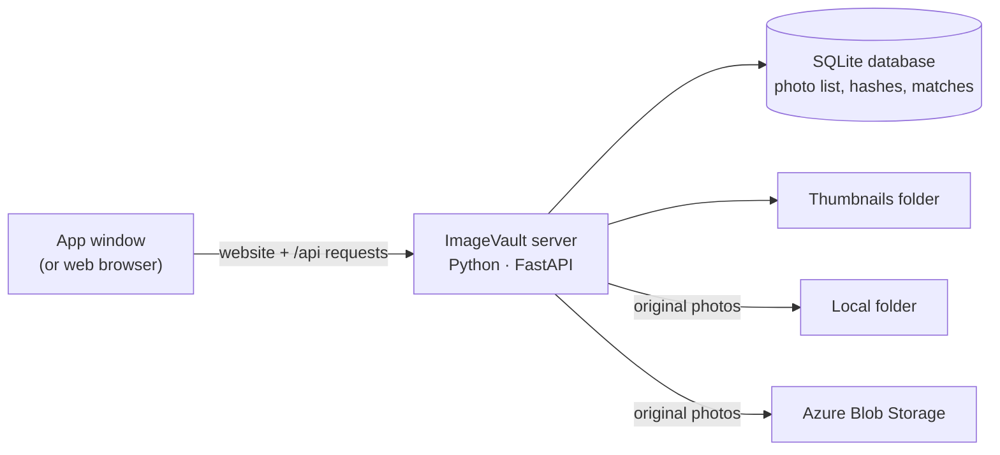
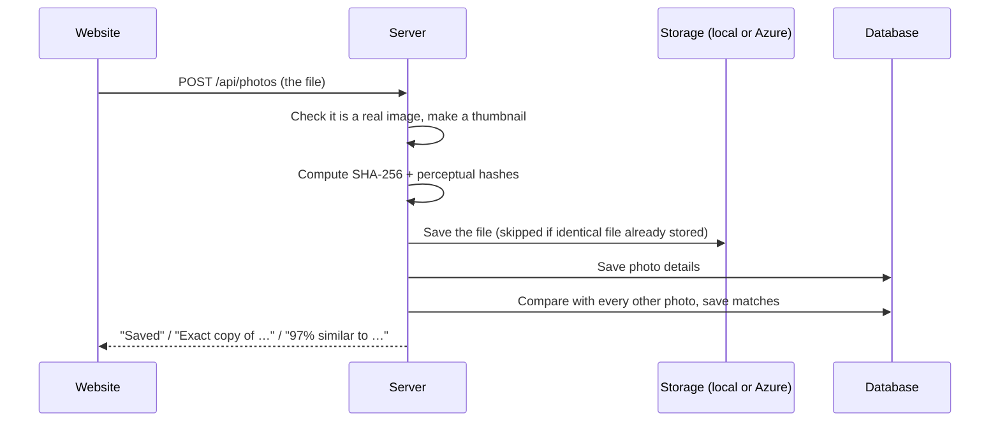

# How ImageVault works

## The big picture

ImageVault is a single Python program. Inside it, a small web server ([FastAPI](https://fastapi.tiangolo.com/)) does two jobs: it serves the website (built with React) and it answers the website's requests through a JSON API.

- **Desktop app:** `python -m app` starts the server on a free port on your computer and opens it in a window (using [pywebview](https://pywebview.flowrl.com/), which uses Microsoft Edge's WebView2). The `.exe` is the same program bundled with [PyInstaller](https://pyinstaller.org/).
- **Website on Azure App Service:** `python -m app --server` runs the same server for the internet, with a password.
- **Storage:** original photos go to a local folder or, once connected, to Azure Blob Storage. The database records where each photo lives, so both kinds keep working.

## What happens when you upload a photo

## How duplicates are detected

### Exact copies: SHA-256

A **SHA-256 hash** turns a file's bytes into a 64-character fingerprint. Change even one byte and the fingerprint is completely different, so two files with the same fingerprint are identical.

ImageVault also uses the fingerprint as the **file name** in storage. When the same photo is uploaded twice, the file is stored only once and both entries point to it.

### Similar photos: perceptual hashes

A resized or re-compressed copy has different bytes, so its SHA-256 differs. To catch it, ImageVault computes two **perceptual hashes**: 64-bit summaries of what the picture *looks like*.

- **dHash (difference hash):** shrink the photo to 9×8 grey pixels. For each pixel, record 1 if it's brighter than the pixel to its right, otherwise 0. That gives 64 bits.
- **pHash (perceptual hash):** shrink to 32×32 grey pixels and use a *discrete cosine transform* (the maths behind JPEG) to find the 8×8 lowest frequencies, which are the overall shapes and lighting. Record 1 for each frequency above the median.

Small changes like resizing, compression or a slight brightness change barely affect these bits. To compare two photos, ImageVault counts how many of the 64 bits differ (the **Hamming distance**):

| Check | Rule |
|---|---|
| Exact copy | Same SHA-256 |
| Similar | pHash differs by ≤ 10 bits **and** dHash differs by ≤ 12 bits **and** the photos have a similar shape |
| Different | Anything else |

The similarity percentage shown in the app is `1 − (pHash bits + dHash bits) / 128`, capped at 99% (100% means byte-for-byte identical).

**Limits:** heavy crops, rotations, mirrored photos and different shots of the same scene are usually *not* detected. That's on purpose: it keeps false matches rare.

### Grouping

Matching photos are joined into groups (with a *union-find* algorithm), and the largest photo in each group is suggested as the **best copy** to keep. "Remove exact copies" deletes only identical files; similar photos are never deleted automatically.

## Where things are in the code

| File | What it does |
|---|---|
| `app/server.py` | All API routes: upload, list, delete, duplicates, settings, login |
| `app/photos.py` | Reading images, thumbnails, SHA-256, pHash, dHash, comparing |
| `app/storage.py` | Saving and loading files: local folder or Azure Blob Storage |
| `app/database.py` | SQLite tables `photos` and `matches` |
| `app/config.py` | The data folder and saved settings |
| `app/__main__.py` | Starts the desktop app or the website server |
| `frontend/src/pages/` | The five pages: Home, Photos, Upload, Duplicates, Settings |
| `tests/test_app.py` | Automated tests for uploading, matching, deleting and settings |

## Cloud concepts used

- **Object storage (Azure Blob Storage):** files are stored as *blobs* in a *container*, addressed by name. The app uses the official `azure-storage-blob` Python library with a connection string.
- **Platform as a Service (Azure App Service):** Azure runs the Python web server for us; we upload code and Azure installs packages and starts it.
- **Resource groups:** all project resources live in one group, so they can be deleted together.
- **CI/CD (GitHub Actions):** every push runs the tests; every version tag builds the Windows app and publishes it as a GitHub release.
