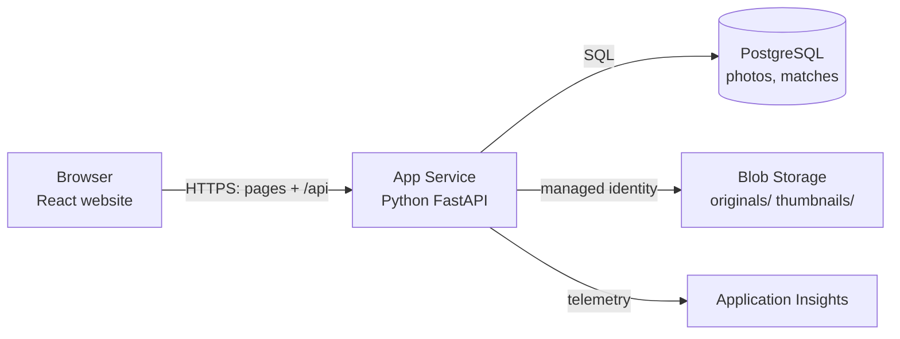
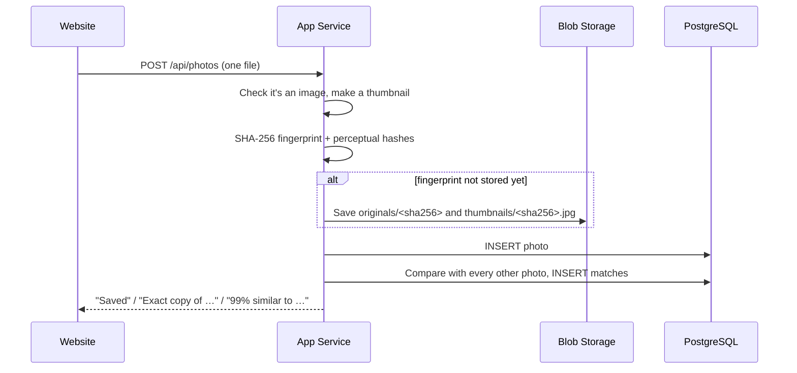

# How ImageVault works

## The big picture

ImageVault is a website. A single Python program ([FastAPI](https://fastapi.tiangolo.com/)) serves the React website and a JSON API (`/api/...`). On Azure it runs on **App Service** and uses three managed services: **PostgreSQL** for data, **Blob Storage** for files and **Application Insights** for monitoring.

The same code also runs on a laptop: without any Azure settings it falls back to a SQLite file and a local folder. That keeps development and testing simple.

## What happens when you upload a photo

The website uploads photos one at a time, so each one is compared with the photos uploaded before it, and each gets its own progress bar.

## How duplicates are detected

### Exact copies: SHA-256

A **SHA-256 hash** turns a file's bytes into a 64-character fingerprint. If even one byte changes, the fingerprint is completely different. So two files with the same fingerprint are identical.

The fingerprint is also the **file name in Blob Storage** (*content-addressed storage*). When the same photo is uploaded twice, the file is stored only once and both database rows point to it. The file is deleted only when the last photo using it is deleted.

### Similar photos: perceptual hashes

A resized or re-compressed copy has different bytes, so its SHA-256 differs. To catch it, ImageVault computes two **perceptual hashes**: 64-bit summaries of what the picture *looks like* (see `app/photos.py`).

- **dHash (difference hash):** shrink the photo to 9×8 grey pixels. For each pixel, write 1 if it's brighter than its right-hand neighbour, otherwise 0. That gives 64 bits.
- **pHash (perceptual hash):** shrink to 32×32 grey pixels and apply a *discrete cosine transform* (the maths behind JPEG). Keep the 8×8 lowest frequencies, which describe the overall shapes and lighting, and write 1 for each one above the median.

Resizing, compression and small edits barely change these bits. To compare two photos, ImageVault counts how many of the 64 bits differ (the **Hamming distance**):

| Result | Rule |
|---|---|
| Exact copy | Same SHA-256 |
| Similar | pHash differs by ≤ 10 bits **and** dHash differs by ≤ 12 bits **and** the photos have a similar shape (aspect ratio within 15%) |
| Different | Anything else |

The similarity shown is `1 − (pHash bits + dHash bits) / 128`, capped at 99%, because 100% means byte-for-byte identical.

The demo photos show both sides: a resized, a compressed and an edited copy are caught, while two different pug photos and two different waterfalls are *not* matched.

**Limits:** heavy crops, rotations, mirrored photos and different shots of the same scene usually aren't detected. That's on purpose, to keep false matches rare. Comparing a new photo with every stored photo is fine for thousands of photos; for millions you'd add an index (see the technical design document).

### Grouping and the "best copy"

Matching photos are joined into groups with a **union-find** algorithm. In each group, ImageVault suggests keeping the photo with the most pixels, then the largest file (least compressed), then the oldest upload. **Remove exact copies** deletes only identical files and keeps the first upload. Similar photos are never deleted automatically.

## Security

- **HTTPS only**, set by Terraform on the Web App.
- **Website password** (`APP_PASSWORD`): an HTTP-only, SameSite session cookie signed with HMAC-SHA256.
- **No storage keys**: the Web App reads and writes blobs with its *system-assigned managed identity*.
- **No deployment passwords**: GitHub Actions signs in with *OpenID Connect* using a federated identity limited to the `main` branch of this repository. FTP and basic-auth publishing are turned off.
- **Private blobs**: public access is disabled, and photos are only served through the authenticated API.
- **Database**: TLS required (`sslmode=require`); the password is generated by Terraform and stored only in the App Settings.

## Where things are in the code

| File | What it does |
|---|---|
| `app/server.py` | All API routes: upload, list, details, delete, duplicates, stats, health, cloud status, login |
| `app/photos.py` | Reading images, thumbnails, SHA-256, pHash, dHash, comparing two photos |
| `app/storage.py` | Saving and loading files: Azure Blob Storage or a local folder |
| `app/database.py` | Tables `photos` and `matches` (SQLAlchemy, so it works with PostgreSQL and SQLite) |
| `app/config.py` | Every setting, read from environment variables |
| `frontend/src/pages/` | Home, Photos, Upload, Duplicates and Cloud pages |
| `infra/main.tf` | Every Azure resource (Terraform) |
| `.github/workflows/ci-cd.yml` | The CI/CD pipeline |
| `tests/test_app.py` | Tests for uploads, matching, grouping, deleting, search, health and the password |
