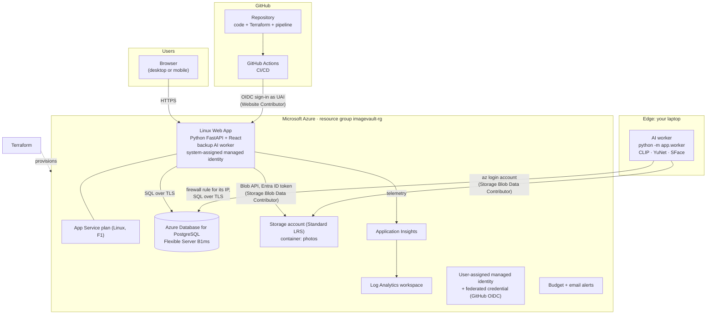
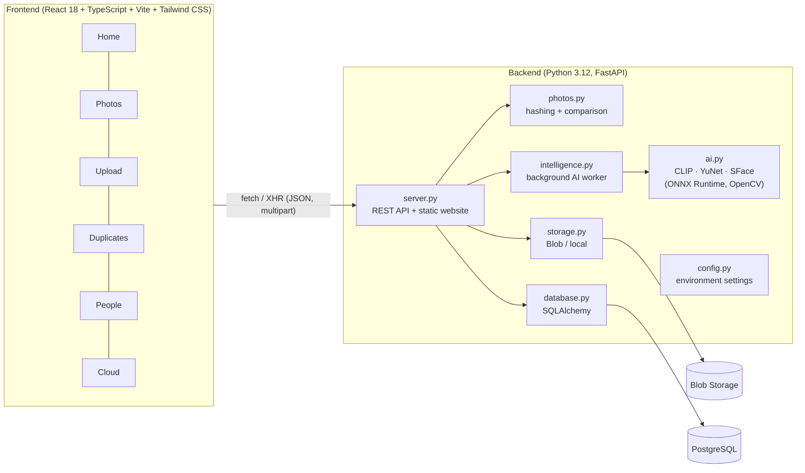
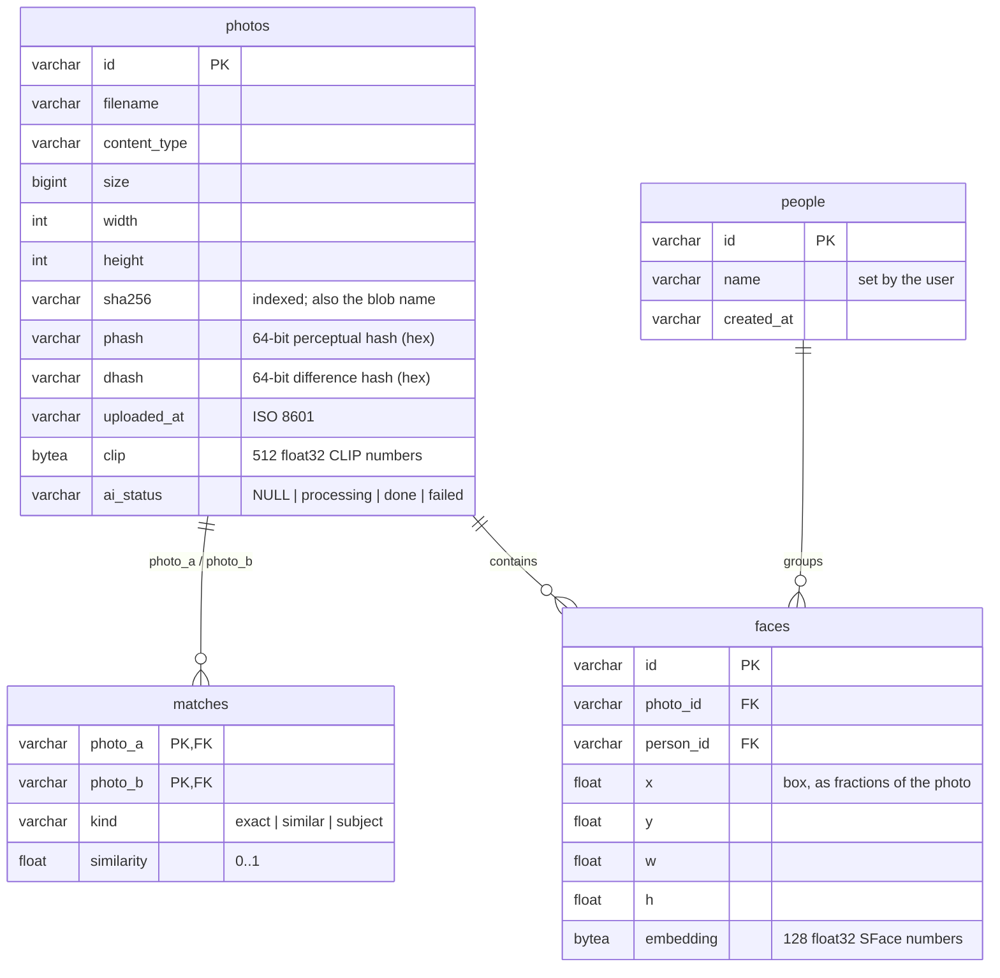
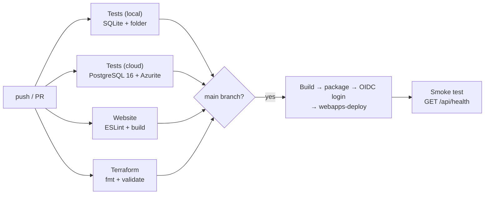

# ImageVault: Technical Design Document

**Course:** Cloud Computing & DevOps (CCD) mini project  
**Project:** ImageVault, a cloud photo vault with duplicate detection  
**Cloud provider:** Microsoft Azure (Azure for Students)  
**Repository:** https://github.com/Arnav-Dugad/imagevault-ai  
**Version:** 3.0.0

---

## 1. Introduction

ImageVault is a web application for storing photos in the cloud. It automatically finds **exact duplicates** (the same file uploaded more than once) and **similar photos** (resized, compressed or edited copies). Users upload photos in the browser, review matching photos side by side, and delete the copies they don't need.

It also includes **free AI recognition** that runs inside the application, with no paid AI service: it recognises the **same person** across photos (People), finds photos by **description** (smart search), and suggests photos of the **same subject taken differently**.

The project's main focus is **cloud architecture and DevOps**, as the guidelines require:

- the application runs on **Azure App Service** and uses three managed services: **Azure Database for PostgreSQL**, **Azure Blob Storage** and **Application Insights**;
- all infrastructure is defined as code with **Terraform**;
- a **GitHub Actions** CI/CD pipeline tests every change and deploys the `main` branch to Azure;
- costs are controlled with an **Azure Cost Management budget** that sends email alerts.

The guidelines ask for at least four cloud managed services or tools. ImageVault uses the following:

| # | Service / tool | Category |
|---|---|---|
| 1 | Azure App Service (Linux, Python 3.12) | Compute, Platform as a Service |
| 2 | Azure Database for PostgreSQL Flexible Server | Managed database |
| 3 | Azure Blob Storage | Managed object storage |
| 4 | Azure Application Insights + Log Analytics | Managed monitoring |
| 5 | Terraform (azurerm provider) | Infrastructure as Code |
| 6 | GitHub Actions | CI/CD pipeline |
| 7 | Azure Cost Management budgets | Cost governance (guideline 7) |
| 8 | Microsoft Entra managed identities + workload identity federation (OIDC) | Identity and security |
| 9 | Laptop AI worker connected to the Azure database and storage | Edge computing (guideline 5 domain) |

## 2. Problem Statement

People keep thousands of photos across phones, laptops and messaging apps. The same picture often exists many times: saved twice, re-shared through WhatsApp (resized and recompressed), or lightly edited. This wastes storage, and in the cloud, storage costs money every month. Finding the copies by hand is slow, and simple file-name or file-size checks miss copies whose bytes differ.

**Goal:** build a cloud-hosted photo vault that

1. stores photos durably in cloud storage;
2. detects exact copies reliably, and stores identical files only once;
3. detects visually similar copies (resized, compressed, edited) without flagging different photos of a similar subject;
4. lets the user review and remove duplicates safely;
5. is deployed, monitored and updated automatically using cloud-native DevOps practices, within a student budget;
6. helps organise photos by **people** and **content** using AI, at no extra cost and without sending photos to third parties.

**Out of scope:** multiple user accounts and mobile apps. Possible extensions are listed in Section 6.

## 3. Solution Architecture

### 3.1 Cloud architecture diagram

### 3.2 Azure resources

All resources are defined in `infra/main.tf` and created in a single resource group, so they can be managed and deleted together.

| Resource | Configuration | Why this choice |
|---|---|---|
| App Service plan + Linux Web App | F1 (free), Python 3.12, HTTPS only, FTP/basic publishing disabled | PaaS: no servers to patch, built-in HTTPS, free tier for students |
| PostgreSQL Flexible Server | Burstable B1ms, 32 GB, PostgreSQL 16, 7-day backups, TLS required | Managed relational database with automatic backups; covered by Azure free services for 12 months |
| Storage account + `photos` container | Standard LRS, TLS 1.2, public blob access disabled | Cheapest durable storage for large binary files |
| Log Analytics + Application Insights | Workspace-based, 30-day retention | Request, error and performance monitoring with a free monthly allowance |
| User-assigned identity + 2 federated credentials | Trusted subjects: `repo:Arnav-Dugad/imagevault-ai:ref:refs/heads/main`, and the ID-based form `repo:Arnav-Dugad@171219870/imagevault-ai@1351190872:ref:refs/heads/main` (IDs looked up from the GitHub API by Terraform) | Lets GitHub Actions deploy without stored secrets |
| Role assignments | Web App → *Storage Blob Data Contributor* and *Cost Management Reader* (resource group); GitHub identity → *Website Contributor* (resource group) | Least privilege: each identity can do only its own job |
| Consumption budget | Monthly (default US$5), alerts at 50% and 80% actual and 100% forecast | Guideline 7: avoids unexpected charges |

### 3.3 Estimated monthly cost (Azure for Students)

| Item | Estimate |
|---|---|
| App Service F1 | US$0 |
| PostgreSQL B1ms + 32 GB | US$0 under the 12-month free services allowance, otherwise about US$13–15 |
| Blob Storage (5 GB, LRS, hot) | about US$0.10 |
| Application Insights / Log Analytics (hard cap 0.1 GB/day, so at most 3 GB/month) | US$0 |
| AI recognition (open-source models on the laptop, or the App Service as backup) | US$0: no API calls, no per-photo charges |
| **Total** | **about US$0–15/month**, well within the US$100 student credit |

### 3.4 Deployment flow

1. **Provision once:** `terraform apply` creates all resources and prints the commands that store the GitHub identity details as repository secrets.
2. **Continuous integration:** every push and pull request runs ruff + pytest, both against SQLite and against PostgreSQL 16 + Azurite (the Azure Storage emulator); then ESLint + a production build of the website; then `terraform fmt` and `validate`.
3. **Continuous deployment:** on `main`, after all checks pass, the pipeline builds the website, packages `app/` + `requirements.txt`, signs in to Azure with OIDC, and deploys with `azure/webapps-deploy`. App Service (Oryx) installs dependencies. A smoke test polls `/api/health` until the new version answers.

## 4. Application Architecture

### 4.1 Components

The frontend is a single-page app that the backend serves as static files, so one App Service hosts both and no CORS setup is needed. Locally, the same backend uses SQLite and a folder when no Azure settings are present. This is the *twelve-factor* idea of configuration through environment variables.

### 4.2 REST API

| Method & path | Purpose |
|---|---|
| `POST /api/photos` | Upload one photo (multipart). Returns the photo and its best match |
| `GET /api/photos?search=&smart=&duplicates_only=&offset=&limit=` | Paginated photo list; search by file name, or by description when `smart=true` |
| `GET /api/photos/{id}` | Photo details, all of its matches, and the faces/people in it |
| `GET /api/photos/{id}/thumb`, `/file` | Thumbnail / original (streamed from Blob Storage, cached by the browser) |
| `DELETE /api/photos/{id}` | Delete a photo; the stored file is removed when its last copy is deleted |
| `GET /api/duplicates` | Duplicate groups with the suggested best copy |
| `POST /api/duplicates/remove-exact` | Remove all exact copies, keeping the first upload of each |
| `GET /api/related` | AI "same subject, different shot" groups (never deleted automatically) |
| `GET /api/people`, `GET /api/people/{id}`, `PUT /api/people/{id}` | Recognised people, their photos, renaming |
| `GET /api/faces/{id}/image` | Face crop used as a person's picture |
| `GET /api/ai` | AI progress: analysed, waiting and failed photos |
| `GET /api/costs` | This month's Azure cost by service (Cost Management Query API), cached for an hour |
| `GET /api/stats` | Dashboard numbers |
| `GET /api/system` | Live health and response time of each cloud service, plus deployment information |
| `GET /api/health` | Health check used by the pipeline's smoke test |
| `GET /api/session`, `POST /api/login`, `POST /api/logout` | Optional password protection |

### 4.3 Data model (PostgreSQL)

**Blob layout:** `originals/<sha256>`, `thumbnails/<sha256>.jpg` (content-addressed) and `faces/<face-id>.jpg` (face crops).

## 5. Technical Designs

### 5.1 Duplicate detection

- **Exact:** SHA-256 of the uploaded bytes. Equal hashes mean identical files.
- **Similar:** two 64-bit perceptual hashes, computed on a greyscale, EXIF-orientation-corrected image:
  - *pHash:* a 32×32 discrete cosine transform; the 8×8 low frequencies are compared with their median;
  - *dHash:* the brightness gradient between neighbouring pixels on a 9×8 image.
- **Decision rule:** pHash Hamming distance ≤ 10 **and** dHash ≤ 12 **and** aspect ratios within 15%. Requiring both hashes to agree cuts false positives.
- **Similarity score:** `1 − (d_pHash + d_dHash) / 128`, capped at 0.99 so that 1.0 always means identical.
- **Grouping:** union-find over the match pairs. The suggested best copy has the most pixels, then the largest file, then the oldest upload.
- **Complexity:** each upload is compared with all *n* stored photos (O(n)) using only the stored 16-character hashes, so the images aren't re-read.

**Validation:** the demo set has 17 real photos. All 8 intended pairs are matched: 1 exact copy, plus resized, WhatsApp-style recompressed, brightness/contrast-edited and heavily compressed copies. The 2 look-alike traps (two different pug photos; two different waterfalls) are not matched, so there were no false positives on this set. The automated tests cover the same cases with generated images.

### 5.2 Storage design

- **Content-addressed blobs** make deduplication automatic: uploading an identical file adds only a database row. The dashboard shows the bytes saved.
- **Reference counting** happens through the database: a blob is deleted only when no photo row with that SHA-256 remains.
- **Thumbnails** (480 px JPEG) are stored once per unique file, so the gallery loads quickly and costs less in Blob transactions.
- **Caching:** photo responses are marked `immutable` for a year, because a photo ID's content never changes.

### 5.3 Security design

| Threat | Control |
|---|---|
| Leaked storage keys | No keys used: the app authenticates to Blob Storage with its managed identity (Entra ID tokens) |
| Leaked deployment credentials | No publish profile or passwords: OIDC federation limited to this repo's `main` branch; basic-auth publishing disabled |
| Eavesdropping | HTTPS only on App Service; TLS 1.2 minimum on storage; `sslmode=require` to PostgreSQL |
| Public access to photos | Container is private; photos are served only through the API after the password check |
| Unauthorised use | `APP_PASSWORD` gate with an HttpOnly, SameSite=Lax, Secure cookie (HMAC-SHA256) |
| Password guessing | After 5 wrong passwords, the address is blocked for 15 minutes (HTTP 429) |
| Malicious uploads | 25 MB limit; files must decode as JPEG/PNG/WEBP/GIF/BMP with Pillow; filenames are sanitised |
| Secrets in git | `terraform.tfvars` and state files are git-ignored; secrets live only in App Settings and GitHub secrets |

### 5.4 Infrastructure as Code

- Terraform ≥ 1.6 with `azurerm ~> 4.0` and `random ~> 3.6`; the provider lock file is committed.
- Random suffixes give globally unique names (storage account, web app).
- The database password is generated by Terraform (`random_password`) and injected into `DATABASE_URL`.
- `lifecycle.ignore_changes` stops harmless drift (the PostgreSQL availability zone; the budget start date).
- Outputs: the website URL and the exact `gh` commands that connect GitHub to Azure.
- The pipeline checks `terraform fmt` and `terraform validate` on every push.

### 5.5 CI/CD pipeline (`.github/workflows/ci-cd.yml`)

The deploy job writes `app/build.json` (commit, time, run link), which the Cloud page shows. That way it's always visible which commit is live.

### 5.6 Monitoring and operations

- The **Azure Monitor OpenTelemetry distro** is enabled when `APPLICATIONINSIGHTS_CONNECTION_STRING` is set. It automatically records every HTTP request (duration, status), dependency calls and exceptions.
- Custom log events: `Photo uploaded` (size, match type, processing time), `Photo analysed` (faces found), `Photo deleted`, `Exact copies removed`, AI model downloads and failures, failed logins and storage errors.
- The **Cloud** page runs live checks: a `SELECT 1` against PostgreSQL and a container existence check against Blob Storage, each with its response time.
- The **budget alerts** email the team at 50%, at 80%, and when spending is forecast to reach 100%.
- **Live cost visibility (FinOps):** the Cloud page shows the month-to-date cost per Azure service. The website's managed identity calls the Cost Management Query API (`ActualCost`, `MonthToDate`, grouped by `ServiceName`) with the read-only *Cost Management Reader* role on the resource group. Results are cached for an hour, because cost data refreshes only a few times a day and the API is rate-limited.

### 5.7 Scalability considerations

The app is stateless: all data lives in PostgreSQL and Blob Storage. So moving from F1 to B1/S1 and adding instances (scale-out) needs no code changes. The O(n) comparison per upload suits a personal library; for very large libraries the next step would be a BK-tree or PostgreSQL index on hash prefixes, and asynchronous processing with Azure Functions + Queue Storage.

### 5.8 Testing

- **19 automated backend tests** (including `tests/test_worker.py`, 5 tests: the website leaves new photos to an online laptop, takes over when photos wait too long or no laptop is online, releases claims of silent workers, and reads the worker settings file):
  - `tests/test_app.py` (11 tests): upload/download, exact copies and storage deduplication including file deletion, resized/compressed/brightened copies, non-matches, grouping and best copy, bulk removal, invalid files, search/filter, health/cloud status, and password protection.
  - `tests/test_ai.py` (3 tests, real public-domain photos): the same person recognised across photos but not confused with another person; a mirrored, cropped, recoloured shot grouped as "same subject" rather than as a copy; smart search finding the right photos, and nothing for an absent subject.
- The same tests run in two modes in CI: SQLite + local folder, and PostgreSQL 16 + Azurite, so the cloud code paths are exercised on every push. The AI models are cached between runs.
- Website: TypeScript type-checking, ESLint, production build.
- Manual end-to-end check with the 32 demo photos (Sections 5.1 and 5.9).
- **Live deployment check (2026-10-25)** on `https://imagevault-4g8kx.azurewebsites.net`:
  - `terraform apply` created all 19 resources;
  - the CD pipeline deployed and passed its smoke test;
  - all 5 services on the Cloud page reported healthy (PostgreSQL 7 ms, Blob Storage 11 ms);
  - 32 demo photos uploaded in 18 s, with the same duplicate, People and same-subject results as locally;
  - the laptop worker, connected to the Azure database and storage, analysed a new upload within 7 s while the website stayed idle.

### 5.9 Free AI recognition

**Requirement:** recognise people and photo content at no cost, on a student subscription, without sending photos to third parties.

**Options considered:**

| Option | Result |
|---|---|
| Azure AI Face (verify/identify same person) | ❌ Limited Access: only for customers managed by Microsoft; not available to students |
| Azure AI Vision multimodal embeddings | ⚠️ Free tier exists but is region-limited and capped per month; adds an external dependency |
| PyTorch CLIP + face libraries (as in v1) | ❌ About 2 GB of libraries; too heavy for the free App Service plan |
| **Quantised ONNX models in the app** (chosen) | ✅ 190 MB of models, about 320 MB of memory, CPU only, free, works offline and locally |

**Design** (`app/ai.py`, `app/intelligence.py`):

- **Models:** CLIP ViT-B/32 (8-bit quantised, via ONNX Runtime) for images and text; YuNet (face detection) and SFace (face embeddings) via OpenCV. They're downloaded once from pinned versions, verified by SHA-256 and stored in `/home/models` on App Service.
- **Asynchronous processing:** uploads mark photos as waiting, and a background worker claims them one at a time with an atomic `UPDATE … WHERE ai_status IS NULL`. Photos interrupted by a restart are retried. Uploads therefore stay fast, and the Home page shows progress.
- **People:** a face joins a person when its SFace cosine similarity with any known face is ≥ 0.363 (OpenCV's recommended threshold); faces that connect two people merge them. Faces under 32 px are ignored.
- **Same subject:** CLIP image cosine ≥ 0.82, excluding pairs that are already copies and pairs where both photos contain faces.
- **Smart search:** the score is the CLIP text-to-image similarity of "a photo of {query}" *minus* the best similarity of generic captions ("a photo.", "a picture."). Results need a margin ≥ 0.015 and must be within 0.045 of the best result.

**Evaluation:**

| Test | Result |
|---|---|
| Face matching, 22 public-domain portraits | Same person 0.60–0.83, different people ≤ 0.28: **100% correctly grouped** at 0.363 |
| Group photo (23 people, 1800 px) | **23/23 faces** detected; Obama (0.81) and Biden recognised; best wrong match 0.29 |
| Same subject (4 Taj Mahal photos, different angles/light) | **All 4 grouped**; portraits of different people correctly *not* grouped |
| Smart search, 15 queries on 32 photos | Correct results for objects, scenes and people; **no results** for absent subjects ("a car", "a bridge") |
| Speed (laptop CPU) | about 25 ms per photo (CLIP) + 50 ms (faces); 32 photos analysed in about 3 s |

**Limitation found:** CLIP judges "the same *kind* of thing", for example two different cats. A geometric check (SIFT keypoints + RANSAC) intended to confirm the *exact same object* was tested and rejected, because it was unreliable on real photos.

### 5.10 Edge computing: AI on the laptop, cloud as backup

**Goal:** keep the free App Service plan (1 GB memory, 60 CPU-minutes a day) light, spend no credit on AI, and never make the website depend on a laptop being switched on.

**Design** (`app/worker.py`, `app/intelligence.py`):

- **The same worker code** runs either as a thread inside the website (`kind = cloud`) or on a laptop (`python -m app.worker`, `kind = laptop`). The laptop connects directly to the Azure PostgreSQL database and Blob Storage.
- **Heartbeats:** every worker updates its row in a `workers` table every 5 seconds (the website's worker every 30). A laptop counts as online if it was seen in the last 20 seconds.
- **Laptop first:** while a laptop is online, the website's worker only claims photos older than 5 minutes (a safety net if the laptop is stuck). Otherwise it claims photos immediately.
- **No double work:** a photo is claimed with an atomic `UPDATE photos SET ai_status = 'processing', ai_worker = :me WHERE id = :id AND ai_status IS NULL`. Claims by a worker silent for 10 minutes are released and retried.
- **Access without new secrets:** Terraform (`laptop_worker = true`) adds a PostgreSQL firewall rule for the deploying computer's public IP (found with the `http` provider), and gives the deploying user's Entra account the *Storage Blob Data Contributor* role. The laptop uses `az login` credentials for Blob Storage; only the database URL is written to a git-ignored `worker.env`.

**Validation:** with the website and the laptop worker running together, all 32 demo photos were analysed by the laptop (`ai_worker = laptop:…`) in about 5 seconds, with the website idle. After the laptop worker was stopped, the next upload was analysed by the website on its own. The Cloud page shows which machine is doing the AI work.

**Trade-offs:** the database firewall is opened to one extra IP address (narrow, TLS-only, password-protected); if the laptop's IP changes, `terraform apply` must be rerun. Photos uploaded while the laptop is offline are analysed by the cloud, so results never stop appearing.

## 6. Lessons Learned

1. **Simpler architectures are easier to run, explain and pay for.** Version 1 used nine containers on a VM (PostgreSQL, Redis, Celery, MinIO, PyTorch CLIP, face recognition, OCR, Prometheus, Grafana) plus Kubernetes and Terraform manifests. It was hard to run, expensive on student credit and hard to demo. Moving to managed PaaS services removed most of the operational work.
2. **Managed services replace a lot of our own code.** Backups (PostgreSQL), durability (Blob Storage), HTTPS certificates (App Service) and dashboards (Application Insights) come built in.
3. **Identity beats secrets.** Managed identities and OIDC federation got rid of storage keys and deployment passwords altogether, so there's less to leak and nothing to rotate.
4. **Same code, different configuration.** Reading every setting from environment variables let the app run on a laptop (SQLite, folder) and in Azure (PostgreSQL, Blob) without code branches. Testing both modes in CI caught SQL differences between SQLite and PostgreSQL early.
5. **Infrastructure as Code makes the environment reproducible.** One `terraform apply` rebuilds everything, and `terraform destroy` stops all costs. The student subscription's region and quota limits are easier to work around by changing one variable than by clicking through the portal again.
6. **Measure accuracy with realistic data.** Real photos, including look-alike "traps", showed that requiring two perceptual hashes to agree avoids false matches. They also exposed a UX issue in choosing the "best copy", which we fixed.
7. **Cost awareness is part of design.** Choosing F1/B1ms tiers, LRS storage, thumbnails and a budget alert from day one kept the project inside the free allowances.
8. **"Managed" isn't always available, so check access early.** Azure's face identification is restricted (Limited Access). Small open-source models, quantised to 8-bit and run with ONNX Runtime, gave the same capability at no cost and within the free plan's memory.
9. **Measure AI before trusting it, and keep what fails out.** Testing on real photos showed CLIP's raw scores can't tell "same object" from "same kind of object". Two things came from that: a face rule for portraits, and comparing searches against generic captions so absent subjects return nothing. A plausible-sounding technique (SIFT + RANSAC verification) was dropped because the measurements showed it was unreliable.
10. **Edge plus cloud gives the best of both.** Moving the heavy AI work to the laptop made it about 10× faster and kept the free cloud plan light, while the cloud fallback means the website keeps working when the laptop is off. Simple database-based coordination (heartbeats and atomic claims) was enough; no message queue was needed.
11. **Real deployments find what local tests can't.** The first CD run failed: GitHub now sends an ID-based OIDC subject (`owner@id/repo@id`), and Azure only trusted the name-based one. Terraform now trusts both, looking the IDs up from the GitHub API. Azure's Cost Management API also rate-limits (HTTP 429), so the cost card caches results and keeps showing the last good numbers.

## 7. Individual Contributions

> Fill in for each team member (2–3 members, same batch).

| Team member | Roll no. | Contributions |
|---|---|---|
| Arnav Dugad | | e.g. backend API and duplicate detection, Azure architecture, Terraform, CI/CD pipeline, documentation |
| *Member 2* | | e.g. React website and UI/UX, testing, demo photos, presentation |
| *Member 3* | | e.g. monitoring and Application Insights, security review, cost analysis, research paper |

## 8. Source Repository Link

**https://github.com/Arnav-Dugad/imagevault-ai**

| Deliverable | Location in the repository |
|---|---|
| Application code | `app/` (backend), `frontend/` (website), `tests/` |
| Infrastructure as Code | `infra/` (Terraform) |
| CI/CD pipeline configuration | `.github/workflows/ci-cd.yml` |
| Deployment guide | `docs/azure-deployment.md` |
| Demo data | `frontend/public/demo-photos.zip` |

## References

- Microsoft Learn: Azure App Service, Azure Database for PostgreSQL Flexible Server, Azure Blob Storage, Application Insights, Managed identities, Workload identity federation, Cost Management budgets.
- HashiCorp: Terraform AzureRM provider documentation.
- GitHub Docs: Configuring OpenID Connect in Azure; `azure/login` and `azure/webapps-deploy` actions.
- N. Krawetz, *Looks Like It* and *Kind of Like That* (2011–2013): average, difference and perceptual image hashing.
- Unsplash License: https://unsplash.com/license (demo photos).
